# Lab-07-Entra-ID-Sign-in-Logs

## 1. Descripción del proyecto

Este laboratorio está inspirado en el capítulo 6 de la primera temporada de *La que se avecina*: **«Un voyeur, una inspección y una tarjeta de crédito»**.

Tras extraviar su cartera en Mirador de Montepinar, Antonio Recio convoca una junta para interrogar a los vecinos y descubrir quién está utilizando su tarjeta de crédito. Javi le advierte que no puede acusar a nadie sin pruebas, pero pronto descubre que Lola ha encontrado la cartera y ha realizado una compra con la tarjeta de su vecino. Berta recomienda cancelar la tarjeta, aunque Antonio se niega porque está obsesionado con desenmascarar al responsable. La situación se complica cuando otros vecinos, conocedores del incidente, también empiezan a utilizarla.

Trasladando esta situación al entorno digital de Mirador de Montepinar S.L., la tarjeta de crédito representa las credenciales de una identidad corporativa. Antonio ha perdido el control de su cuenta y comienzan a producirse distintos intentos de acceso que requieren una investigación.

Nuestra misión será descubrir qué ha sucedido utilizando los registros de inicio de sesión (*Sign-in Logs*) de Microsoft Entra ID. A través de Microsoft Graph PowerShell y herramientas de análisis, investigaremos las autenticaciones, identificaremos comportamientos anómalos y recopilaremos evidencias para reconstruir el incidente.

Al igual que Javi insiste en no acusar a ningún vecino sin pruebas, nuestro objetivo será diferenciar los hechos registrados de las simples sospechas y elaborar un diagnóstico fundamentado en evidencias técnicas.

### Objetivos técnicos

- Localizar y consultar los registros de inicio de sesión de Microsoft Entra ID.
- Interpretar los resultados de autenticación y los códigos de error disponibles.
- Diferenciar los posibles fallos de credenciales, autenticación multifactor y Acceso Condicional.
- Examinar los detalles de los intentos de inicio de sesión para formular y comprobar hipótesis.
- Correlacionar las evidencias disponibles con la identidad, la aplicación, el dispositivo y el contexto del acceso.
- Identificar patrones de autenticación fallida y posibles comportamientos sospechosos.
- Recuperar y exportar registros mediante Microsoft Graph PowerShell.
- Automatizar el filtrado y análisis de eventos utilizando PowerShell.
- Documentar el incidente, las evidencias recopiladas y las posibles acciones correctivas.
- Comprender las limitaciones de los registros disponibles según los permisos, las licencias y la configuración del tenant.

## 2. Estructura del proyecto

Antonio Recio quiere saber quién está utilizando su tarjeta y qué ha ocurrido realmente en Mirador de Montepinar. Para investigar el incidente, el laboratorio se organiza en cinco bloques: datos, scripts, consultas, informes y evidencias.

### `data/` — Los registros de Montepinar

Almacena muestras anonimizadas de los registros de inicio de sesión (*Sign-in Logs*) obtenidos desde Microsoft Entra ID. Estos datos servirán para realizar pruebas y analizar los eventos sin publicar información sensible del tenant.

### `scripts/` — La investigación de Antonio Recio

Contiene los scripts PowerShell utilizados para conectarse a Microsoft Graph, recuperar los registros de autenticación, filtrar eventos y automatizar su análisis.

### `queries/` — El interrogatorio de Montepinar

Incluye las consultas KQL utilizadas para investigar patrones de autenticación en Azure Log Analytics, como intentos fallidos, resultados de MFA y actividad sospechosa.

### `reports/` — Los informes de la junta

Guarda los resultados del análisis, incluyendo exportaciones CSV e informes en Markdown con los errores detectados, los eventos relevantes y las conclusiones de la investigación.

### `screenshots/` — Las pruebas del delito

Contiene las capturas de pantalla que documentan las distintas fases de implementación y las pruebas realizadas durante la investigación. Las evidencias se organizan en subcarpetas según cada fase del laboratorio y se incrustan directamente en el README para facilitar la comprensión de los procedimientos y resultados obtenidos.

### Flujo de trabajo

1. Se generan distintos eventos de autenticación en Microsoft Entra ID.
2. Se consultan los Sign-in Logs y se recuperan los registros mediante Microsoft Graph PowerShell.
3. Se procesan los eventos mediante scripts PowerShell y, opcionalmente, consultas KQL.
4. Se documentan los hallazgos y se generan los informes correspondientes.
5. Se recopilan las evidencias para reconstruir el incidente y proponer medidas correctivas.

Así, Antonio podrá dejar de sospechar de todos los vecinos por igual y descubrir qué ha ocurrido realmente con su identidad. Porque en Montepinar se puede acusar a cualquiera, pero en IAM hacen falta evidencias.

**Nota sobre las evidencias:** Las capturas han sido anonimizadas para proteger la información del entorno de laboratorio. Se han añadido anotaciones visuales para destacar los campos relevantes para cada análisis, sin alterar los resultados técnicos originales.

## 3. Fases de implementación

### T01. Preparación de la identidad y validación de una autenticación correcta (T01)

El primer paso consiste en preparar la identidad de Antonio Recio y comprobar que puede autenticarse correctamente en Microsoft Entra ID. Esta primera prueba servirá como referencia para comparar los siguientes escenarios de autenticación.

#### 1.1. Preparación y sincronización de la identidad

Se comprueba que la cuenta de Antonio Recio existe en Active Directory, dentro de la siguiente estructura:

```text
OU=Usuarios
└── OU=Montepinar
    └── Antonio Recio
```

Como no se disponía de la contraseña original, se realiza un restablecimiento desde Active Directory Users and Computers.

Posteriormente, se solicita la sincronización del hash de la contraseña mediante Microsoft Entra Connect y PowerShell:

```powershell
Import-Module ADSync

Invoke-ADSyncCSObjectPasswordHashSync `
    -ConnectorName "montepinar.local" `
    -DistinguishedName "CN=Antonio Recio,OU=Usuarios,OU=Montepinar,DC=montepinar,DC=local"
```

La operación finaliza correctamente y permite utilizar la nueva contraseña para autenticarse en Microsoft Entra ID.

#### 1.2. Generación del evento de autenticación

Para generar el primer evento, se inicia sesión con la cuenta de Antonio Recio en Microsoft My Account:

https://myaccount.microsoft.com/

Una vez completada la autenticación, se accede al centro de administración de Microsoft Entra y se consultan los registros desde:

`Entra ID > Monitoring & health > Sign-in logs > User sign-ins (interactive)`

Tras localizar los eventos correspondientes a Antonio, se identifican tres registros:

| Aplicación | Recurso | Resultado |
|---|---|---|
| My Profile | Microsoft Graph | Success |
| My Profile | Microsoft Graph | Success |
| My Sign-ins | Microsoft Graph | Success |

Los tres eventos muestran un resultado satisfactorio y corresponden a operaciones realizadas sobre Microsoft Graph.

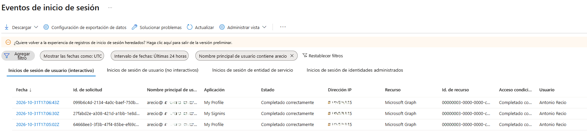

#### 1.3. Análisis de los detalles de autenticación

Se selecciona uno de los eventos de My Profile para examinar sus detalles.

En el apartado Authentication Details se obtiene la siguiente información:

| Campo | Resultado |
|---|---|
| Authentication method | Previously satisfied |
| Succeeded | Yes |
| Result detail | MFA requirement satisfied by claim in the token |

El requisito de autenticación multifactor aparece satisfecho mediante una claim incluida en el token. Esto indica que Microsoft Entra ha reconocido una evidencia MFA previamente satisfecha, sin que el registro demuestre que se haya realizado un nuevo desafío MFA durante este evento.

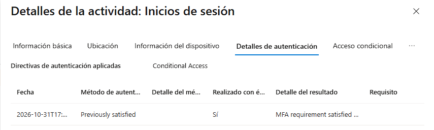

#### 1.4. Comprobación de Acceso Condicional

En el apartado Conditional Access se identifica la siguiente política:

| Campo | Resultado |
|---|---|
| Policy | CA-Montepinar-MFA |
| Grant control | MFA |
| Result | Completed successfully |

La política de Acceso Condicional se ha evaluado correctamente y el requisito de autenticación multifactor se ha satisfecho, permitiendo continuar con el acceso.

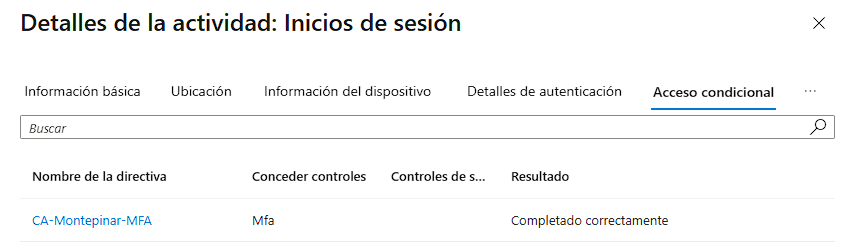

#### 1.5. Resultado de la prueba

La prueba T01 finaliza satisfactoriamente. Antonio Recio consigue autenticarse en Microsoft Entra ID y se generan registros que permiten analizar el acceso desde distintas perspectivas.

Esta primera comprobación establece una referencia de comportamiento normal para las siguientes pruebas del laboratorio, en las que se investigarán errores de autenticación y posibles usos no autorizados de la identidad.

### T02. Investigación de un intento de autenticación fallido

#### 2.1. Ejecución de la prueba

Una vez validada la autenticación correcta de Antonio Recio en T01, se realiza una segunda prueba para analizar el comportamiento de Microsoft Entra ID ante unas credenciales incorrectas.

Para ello, se inicia una nueva sesión privada del navegador y se accede a Microsoft My Account utilizando la identidad de Antonio Recio (`arecio`). Durante el proceso se introduce deliberadamente una contraseña incorrecta y se realiza un único intento de autenticación.

Posteriormente, se accede a **Microsoft Entra ID → Monitoring & health → Sign-in logs → User sign-ins (interactive)** para localizar e investigar el evento generado.

#### 2.2. Análisis de la información básica (Basic info)

El registro muestra un intento de autenticación fallido con los siguientes datos:

- **Status:** Error.
- **Sign-in error code:** 50126.
- **Failure reason:** Error validating credentials due to invalid username or password.
- **Application:** My Profile.
- **Resource:** Microsoft Graph.
- **Client app:** Browser.
- **Authentication requirement:** Single-factor authentication.

El código **50126 (AADSTS50126)** identifica un error durante la validación de las credenciales, indicando que el nombre de usuario o la contraseña no son válidos.

En esta prueba, al haberse introducido deliberadamente una contraseña incorrecta, se confirma que el fallo se produce durante la autenticación primaria.

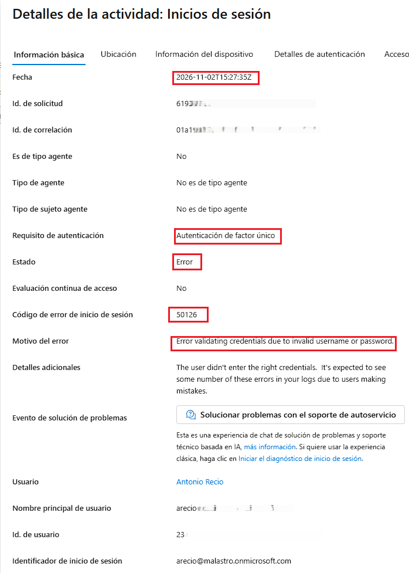


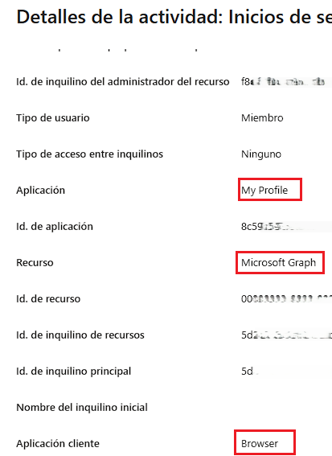

#### 2.3. Análisis de los detalles de autenticación (Authentication Details)

Al revisar los detalles de autenticación, se obtienen los siguientes resultados:

- **Authentication method:** Password.
- **Authentication method detail:** Password Hash Sync.
- **Succeeded:** No.
- **Result detail:** Invalid username or password or Invalid on-premise username or password.

El registro confirma que el intento de validación mediante contraseña no tuvo éxito.

El método **Password Hash Synchronization (PHS)** permite validar las credenciales en Microsoft Entra ID mediante el hash de contraseña sincronizado desde Active Directory local.

En este entorno híbrido, el resultado es coherente con la prueba realizada: se ha introducido una contraseña incorrecta y la autenticación primaria ha sido rechazada.

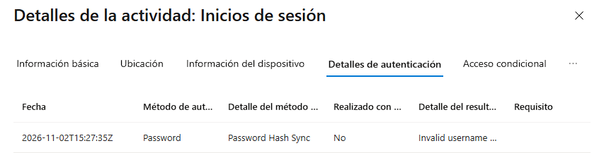

#### 2.4. Revisión de Conditional Access

Al consultar la pestaña **Conditional Access**, el evento muestra el resultado **Not available**.

Por tanto, este registro no proporciona un resultado de evaluación de las políticas de acceso condicional para el intento investigado.

No se puede concluir que la política `CA-Montepinar-MFA` haya bloqueado la autenticación ni atribuirle el fallo observado. La causa identificada corresponde a la validación incorrecta de las credenciales.

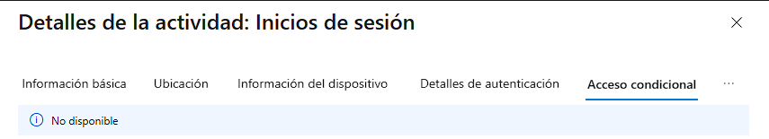

#### 2.5. Resultado y conclusiones de la prueba

La investigación permite identificar que el intento de autenticación de Antonio Recio ha fallado durante la validación de las credenciales, generando el código de error **50126**.

El análisis de Authentication Details confirma que el método Password, mediante Password Hash Sync, no ha conseguido validar las credenciales.

Es importante diferenciar este resultado de un fallo de autenticación multifactor (MFA): en esta prueba la autenticación primaria no se ha completado, por lo que no existe evidencia de que se haya llegado a ejecutar un desafío MFA.

**Conclusiones técnicas:**

- Se ha identificado y analizado un intento de autenticación fallido.
- Se ha interpretado el código de error 50126.
- Se ha comprobado el resultado de la validación mediante Password Hash Sync.
- Se ha diferenciado un fallo de contraseña de un posible fallo de MFA.
- Se ha revisado Conditional Access, documentando que el resultado no estaba disponible para este evento.

### 4. T03 — Fallo de autenticación multifactor (MFA)

#### 4.1. Objetivo de la prueba

En esta prueba se analiza un escenario en el que un usuario introduce correctamente sus credenciales, pero no completa el segundo factor de autenticación solicitado por Microsoft Entra ID.

El objetivo es identificar cómo se registra este comportamiento en los Sign-in Logs y comprobar la relación entre la autenticación primaria, la verificación MFA y la política de Acceso Condicional.

En esta ocasión, Antonio Recio consigue validar su contraseña, pero rechaza la solicitud de comprobación recibida en Microsoft Authenticator.

#### 4.2. Ejecución de la prueba

Se utilizó una ventana privada del navegador para iniciar una nueva sesión con la cuenta de Antonio Recio.

Tras introducir la contraseña correcta, Microsoft solicitó una comprobación de identidad mediante Microsoft Authenticator. En el dispositivo móvil se seleccionó la opción «No, no soy yo», rechazando la solicitud de autenticación.

El navegador mostró el mensaje de acceso denegado.

**Evidencia de la solicitud rechazada:**

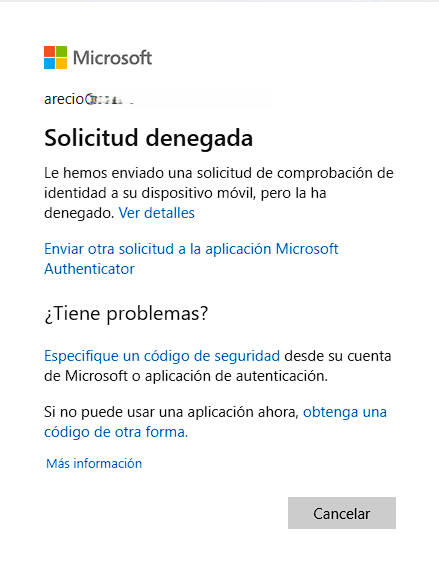

#### 4.3. Basic info — Información general del evento

Una vez localizado el evento en Microsoft Entra ID → Monitoring & health → Sign-in logs → User sign-ins (interactive), se analizaron sus datos generales.

Los principales resultados fueron:

| Campo | Resultado |
|---|---|
| Status | `Interrupted` |
| Authentication requirement | `Multi-factor authentication` |
| Additional details | `User needs to perform multi-factor authentication` |
| Fecha del evento | `2026-11-02 16:46:45 UTC` |

El estado `Interrupted` indica que el proceso de inicio de sesión quedó interrumpido porque era necesario completar la autenticación multifactor.

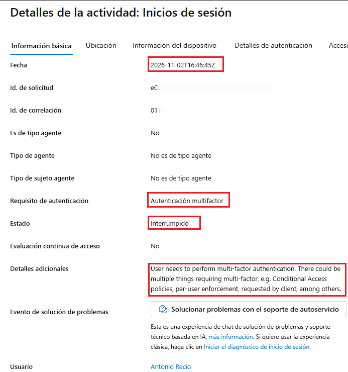

También se revisaron la aplicación, la aplicación cliente y el recurso asociado al evento para identificar el contexto de la solicitud.

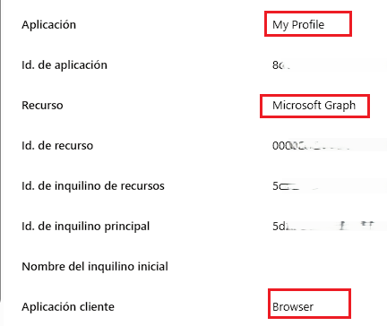

#### 4.4. Authentication Details — Detalles de autenticación

El análisis de Authentication Details permitió diferenciar el resultado de la autenticación primaria del resultado de la verificación multifactor.

Se observaron dos pasos:

| Método de autenticación | Detalle | Succeeded | Result detail |
|---|---|---|---|
| Password | Password Hash Sync | Yes | Correct password |
| Mobile app notification | — | No | Authentication in progress |

**Interpretación técnica:**

- **Autenticación primaria:** la contraseña se validó correctamente mediante Password Hash Sync.
- **Autenticación multifactor:** Microsoft solicitó una notificación en la aplicación móvil, pero este paso no se completó.
- **Resultado:** el proceso de autenticación quedó interrumpido al no completarse el segundo factor.

Es importante distinguir ambos resultados: el usuario no tuvo un problema de contraseña, sino que no completó el proceso de MFA requerido.

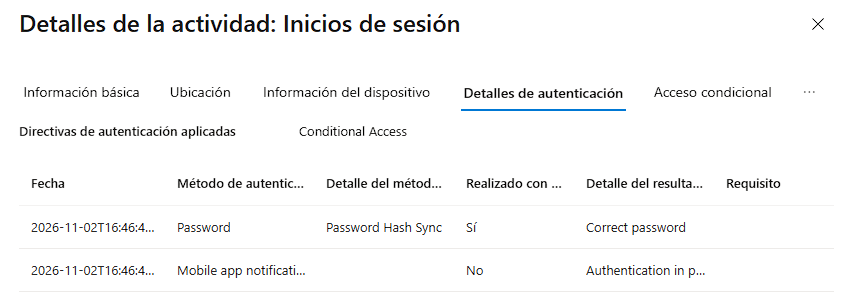

#### 4.5. Conditional Access — Acceso Condicional

Se revisó la política `CA-Montepinar-MFA`, responsable de exigir autenticación multifactor para el acceso.

Los resultados observados fueron:

| Campo | Resultado |
|---|---|
| Policy | `CA-Montepinar-MFA` |
| Grant control | `MFA` |
| Result | `Error` |

La política exigía MFA como condición para completar el acceso. El resultado `Error` es coherente con el hecho de que el requisito multifactor no llegó a completarse.

No debe interpretarse este resultado, por sí solo, como un error de configuración de la política. Debe analizarse conjuntamente con el estado del inicio de sesión y los detalles de autenticación.

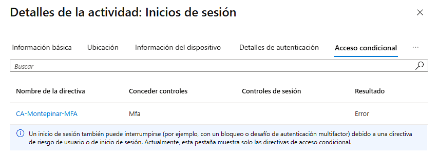

#### 4.6. Resultado y conclusiones

La investigación permitió identificar un escenario en el que la autenticación primaria se completa correctamente, pero el acceso no llega a concederse porque el proceso MFA queda incompleto.

Los resultados demuestran que:

1. La contraseña del usuario era correcta.
2. La autenticación primaria se validó mediante Password Hash Sync.
3. Microsoft Entra ID solicitó una segunda verificación mediante Microsoft Authenticator.
4. La notificación móvil no se completó.
5. El inicio de sesión quedó registrado con estado `Interrupted`.
6. La política `CA-Montepinar-MFA` exigía MFA y mostró un resultado `Error`.

**Conclusión:** una autenticación primaria satisfactoria no implica que el usuario haya conseguido acceder. Cuando una política de Acceso Condicional exige MFA, el usuario debe completar también el segundo factor para satisfacer los requisitos de acceso.

Este escenario permite diferenciar tres situaciones:

| Prueba | Escenario | Resultado |
|---|---|---|
| T01 | Autenticación satisfactoria | Success |
| T02 | Contraseña incorrecta | Error `50126` |
| T03 | Contraseña correcta, MFA incompleto | Interrupted |

La comparación demuestra la importancia de analizar los detalles de autenticación y no limitar una investigación al estado general del evento.

---

Esta prueba establece una referencia para las siguientes fases del laboratorio, en las que se investigarán otros escenarios de autenticación y los controles de seguridad asociados.

### 5. T04 – Conditional Access Block Test

#### 5.1. Objetivo de la prueba

El objetivo de esta prueba es comprobar cómo una política de **Conditional Access** puede impedir el acceso a una aplicación incluso cuando el usuario introduce correctamente sus credenciales.

Para ello, se creó una política adicional denominada `CA-Montepinar-Block-Test`, sin modificar la política original `CA-Montepinar-MFA`.

La política se configuró con los siguientes parámetros:

- **Users:** únicamente Antonio Recio (`arecio`).
- **Exclude:** cuenta administrativa y cuenta de emergencia (*break-glass*).
- **Target resources:** All cloud apps.
- **Grant:** Block access.
- **Initial state:** Report-only.

#### 5.2. Evaluación en modo Report-only

Con la política configurada en modo `Report-only`, se inició sesión con Antonio utilizando la contraseña correcta y completando el proceso de autenticación multifactor.

El acceso se completó correctamente. Sin embargo, en los registros de Conditional Access se observó que la nueva política habría producido un resultado de error si hubiese estado habilitada.

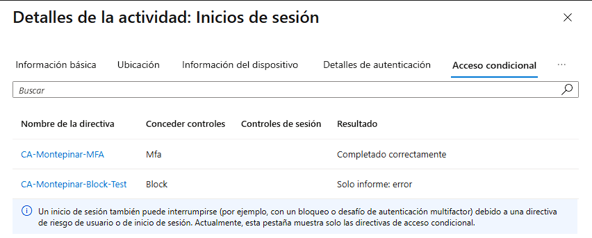

En el registro se identificaron dos políticas:

| Política | Control | Resultado |
|---|---|---|
| `CA-Montepinar-MFA` | MFA | Completado correctamente |
| `CA-Montepinar-Block-Test` | Block | Solo informe: error |

Esto demuestra que el modo Report-only permite evaluar el impacto de una política sin aplicar realmente el bloqueo al usuario.

### 5.3. Activación de la política y bloqueo del acceso

Una vez comprobado el resultado de la simulación, se cambió el estado de `CA-Montepinar-Block-Test` a `Enabled`.

A continuación, se abrió una nueva sesión privada del navegador y se repitió el inicio de sesión con Antonio, utilizando nuevamente la contraseña correcta.

Esta vez, Microsoft Entra ID impidió el acceso y mostró el siguiente mensaje:

> No tiene permiso para acceder a este recurso. Ha iniciado sesión correctamente, pero no tiene permiso para acceder a este recurso.


#### 5.4. Análisis de los registros de inicio de sesión

Tras localizar el evento correspondiente en **Sign-in logs**, se identificaron los siguientes datos:

| Campo | Resultado |
|---|---|
| Status | Error |
| Sign-in error code | `53003` |
| Failure reason | Access has been blocked by Conditional Access policies |
| Authentication requirement | Multi-factor authentication |

El código `53003` indica que el acceso ha sido bloqueado por una política de Conditional Access, impidiendo la emisión del token de acceso.

En el apartado **Authentication Details** se comprobó que la contraseña había sido validada correctamente:

| Método | Detalle | Resultado |
|---|---|---|
| Password | Password Hash Sync | Succeeded: Yes |

El registro mostraba también un segundo valor `No`, pero no proporcionaba información suficiente para identificar el método o interpretar de forma concluyente ese paso. Por tanto, no se atribuye a esta prueba una confirmación de MFA completado.

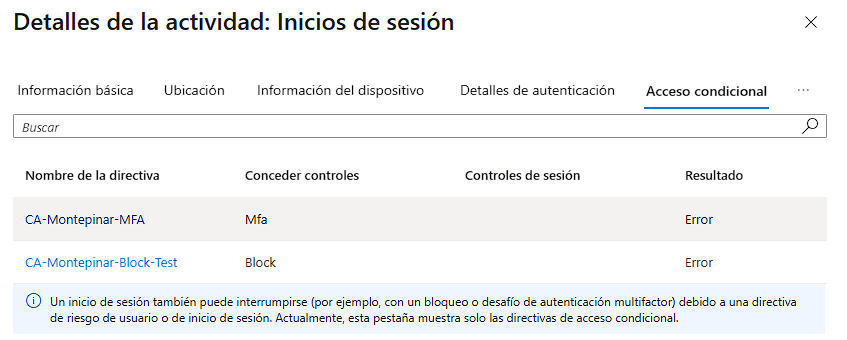

Los resultados mostraron:

| Política | Control | Resultado |
|---|---|---|
| `CA-Montepinar-MFA` | MFA | Error |
| `CA-Montepinar-Block-Test` | Block | Error |

La política `CA-Montepinar-Block-Test` aplicó el control de bloqueo configurado. El código `53003` y el motivo del fallo confirman que Conditional Access impidió el acceso.

#### 5.5. Conclusiones

Esta prueba permitió comprobar la diferencia entre los modos **Report-only** y **Enabled** de Conditional Access:

- **Report-only:** evalúa el impacto de una política sin bloquear realmente el acceso.
- **Enabled:** aplica los controles configurados y puede impedir la emisión de tokens.
- Una contraseña correcta no garantiza que el usuario pueda acceder al recurso.
- El código `53003` permite identificar un bloqueo provocado por políticas de Conditional Access.

Finalmente, la política `CA-Montepinar-Block-Test` se devolvió al estado `Report-only` para evitar mantener un bloqueo activo en el entorno de laboratorio.

La prueba demuestra la importancia de evaluar las políticas mediante Report-only antes de habilitarlas en un entorno real, reduciendo el riesgo de bloquear accesos legítimos.

